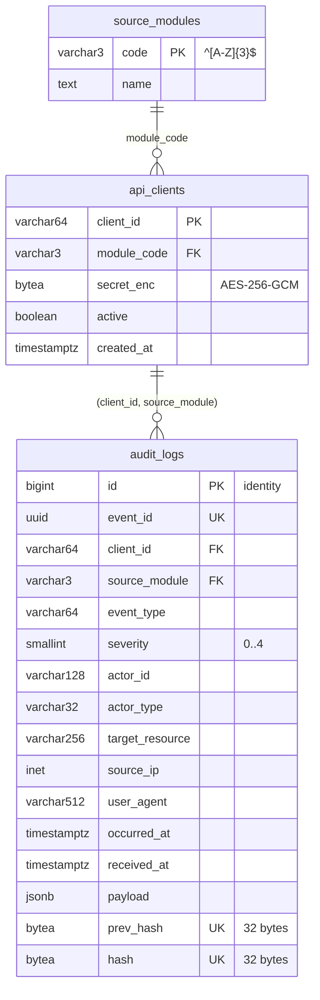
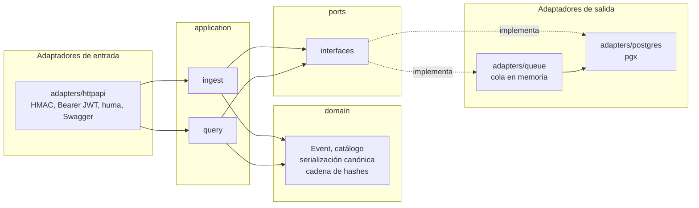
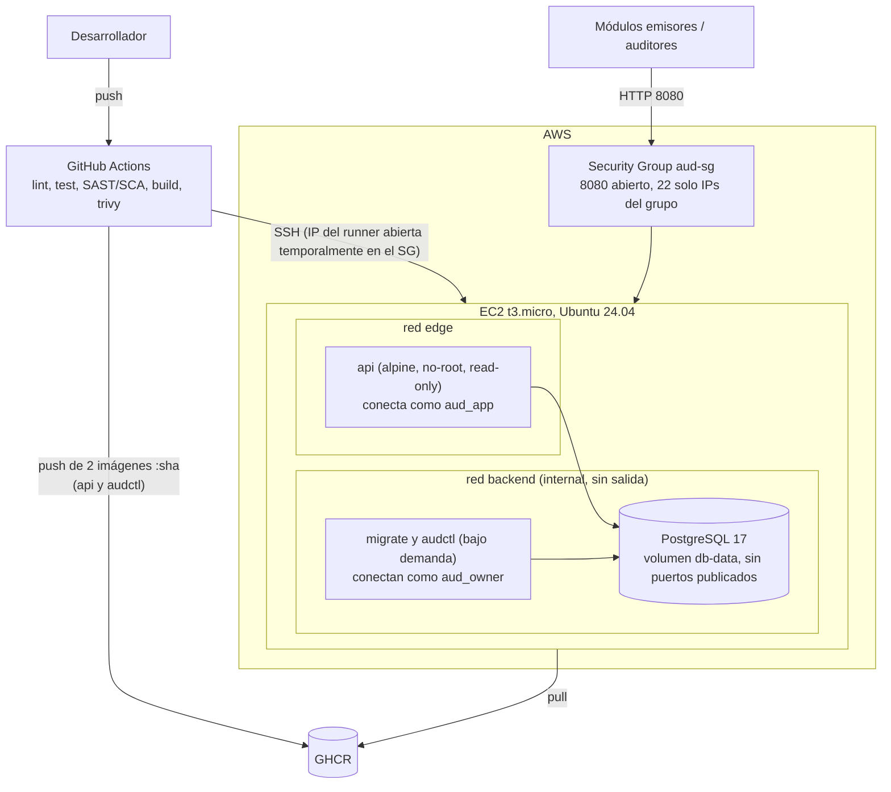

# Informe técnico — Módulo AUD: Auditoría y Trazabilidad de Seguridad

MediNet-Core · Desarrollo Seguro (CI3064) · Evaluación 02

> **Estado del borrador.** Las secciones marcadas con `[PENDIENTE]` dependen de etapas aún abiertas del [ROADMAP](../ROADMAP.md) (5.5 instancia EC2, 6.1 y 6.3 pruebas y defensas) o de decisiones del grupo y del profesor. Las rutas de evidencia se verificaron contra el commit `2211455`.

## 1. Resumen

AUD es el módulo de MediNet-Core que **recibe, almacena de forma inmutable y expone para consulta** los eventos de seguridad emitidos por los otros 11 módulos. Ofrece:

- **Ingesta** (`POST /api/v1/events`, y por lote en `/events/batch`): autenticada con HMAC por cliente, con protección contra replay; responde `202` y persiste de forma asíncrona.
- **Consulta** (`/api/v1/events`, `/events/{id}`, `/stats/suspicious`, `/integrity/verify`): protegida con JWT RS256 y roles `auditor` / `admin`.
- **Inmutabilidad verificable:** permisos de BD + trigger + cadena de hashes.
- **Documentación** OpenAPI 3.1 con Swagger UI en `/docs`.

Stack: Go 1.26, PostgreSQL 17, Docker Compose, GitHub Actions, AWS EC2.

## 2. Modelo de datos y arquitectura (7.1)

### 2.1 Modelo entidad-relación

Fuente: [`migrations/000001_init_schema.up.sql`](../migrations/000001_init_schema.up.sql).

Puntos clave:

- **FK compuesta** `(client_id, source_module) → api_clients(client_id, module_code)`: un cliente no puede emitir eventos en nombre de otro módulo.
- **`UNIQUE(prev_hash)`**: la cadena no puede bifurcarse.
- **`UNIQUE(event_id)`**: idempotencia ante reintentos del emisor.
- **Índices** para los filtros de consulta y la paginación por cursor: `(occurred_at DESC, id DESC)`, `(event_type, occurred_at)`, `(severity, occurred_at)`, `(actor_id, occurred_at)`, `(source_module, occurred_at)`.
- `secret_enc` guarda el secreto HMAC cifrado (no se puede *hashear*: verificar un HMAC exige el secreto original). La clave de cifrado vive fuera de la BD.

### 2.2 Arquitectura hexagonal del backend

La capa `domain` no tiene dependencias externas; la aplicación solo conoce interfaces (`ports`). Detalle de decisiones en la sección "Decisiones de diseño" del [ROADMAP](../ROADMAP.md).

**Flujo de ingesta:** firma HMAC y anti-replay → validación y re-codificación del payload → `202 Accepted` → cola → transacción que calcula `hash = SHA256(prev_hash ‖ evento canónico)` e inserta. Los errores permanentes (SQLSTATE clases 22 y 23) descartan el evento con un log `ERROR`; los demás se reintentan.

### 2.3 Despliegue

`api` está en las dos redes: `edge` para publicar el puerto y `backend` para llegar a la BD. `migrate` y `audctl` (perfil `tools` de Compose) solo existen mientras corren y nunca comparten contenedor con la API.

`[PENDIENTE 5.5]` Confirmar el diagrama contra la instancia real. `[PENDIENTE: decisión del grupo]` TLS con dominio (Caddy) o solo IP pública.

## 3. ISO/IEC 27034 (7.2)

### 3.1 Marco normativo

- **ONF (Organization Normative Framework):** el conjunto de controles que la organización (MediNet-Core) exige a toda aplicación: autenticación de las APIs, trazabilidad, gestión de secretos, contenedores endurecidos, pipeline con escaneo. `[PENDIENTE: confirmar con el grupo qué parte viene impuesta por la asignatura y qué parte definió el módulo.]`
- **ANF (Application Normative Framework):** el subconjunto del ONF aplicable a AUD, ajustado por su contexto: aplicación de **alto valor** (es la fuente de verdad forense del hospital), con datos sensibles potenciales en el `payload`, expuesta a otros módulos y a auditores.
- **Nivel de confianza objetivo (ALoC):** `[PENDIENTE: proponer, p. ej. nivel alto, con la justificación de que el módulo es la mitigación de A09 para todo MediNet-Core.]`

### 3.2 Application Security Controls (ASC)

| # | Requisito / amenaza | Control (ASC) | Implementación | Evidencia |
|---|---|---|---|---|
| 1 | Los registros no pueden alterarse ni borrarse | Inmutabilidad en 3 capas | Rol `aud_app` con solo `SELECT, INSERT`; triggers que rechazan `UPDATE/DELETE` y `TRUNCATE` incluso al dueño; cadena de hashes con `UNIQUE(prev_hash)` | `migrations/000001_init_schema.up.sql`; `deploy/initdb/01-roles.sh`; `internal/audit/domain/chain_test.go`; [transcripción](evidencias/inmutabilidad-e-integridad.txt) §2–3; `[PENDIENTE 6.1: tests automatizados de UPDATE/DELETE/TRUNCATE como aud_app]` |
| 2 | Detectar manipulación hecha con privilegios | Verificación de integridad | `GET /integrity/verify` recalcula la cadena en una transacción `REPEATABLE READ` de solo lectura y devuelve el primer id roto | `internal/audit/adapters/postgres/query.go`; `TestVerifyChainDetectsTamperingByTheOwner` y `TestVerifyChainRange` (`adapters/postgres`); `e2e_query_test.go`; [transcripción](evidencias/inmutabilidad-e-integridad.txt) §4–6 |
| 3 | Suplantación de un módulo emisor | Autenticación HMAC por cliente + FK compuesta | Firma sobre el body crudo, ventana de ±5 min anti-replay, cliente atado a su módulo, mismo `401` para cualquier falla | `internal/audit/adapters/httpapi/hmac.go`; `TestSignatureRejections` (`hmac_test.go`); [CONTRATO_INGESTA.md](CONTRATO_INGESTA.md) |
| 4 | Acceso indebido a la consulta | JWT RS256 + RBAC | `WithValidMethods(["RS256"])`, llave RSA de al menos 2048 bits; roles `auditor`/`admin`; sin clave pública configurada, la API de consulta queda deshabilitada | `internal/jwtauth/jwtauth.go`; `TestVerifyRejectsInvalidTokens` (`alg: none`, confusión HS256, otra llave, payload alterado); `internal/audit/adapters/httpapi/bearer.go`; [transcripción](evidencias/inmutabilidad-e-integridad.txt) §4 (403 a un auditor) |
| 5 | Inyección (SQLi, JSON malicioso) | Consultas parametrizadas y validación de entrada | `pgx` con parámetros; CHECKs en la BD; límites de tamaño (64 KiB por evento, 1 MiB por lote, 16 KiB de payload), profundidad y rango; catálogo de `event_type`; campos desconocidos rechazados | `internal/audit/adapters/postgres/`; `TestNewEventRejectsInvalidInput` (`domain/event_test.go`); `TestBodyOverTheLimitIsRejected` (`hmac_test.go`) |
| 6 | Robo de secretos de clientes | Cifrado en reposo | AES-256-GCM con `client_id` como dato adicional (un secreto copiado a otro cliente no descifra); clave en `.env` | `internal/secretbox/secretbox.go`, `secretbox_test.go`; `internal/audit/adapters/postgres/clients.go` |
| 7 | Credenciales en el repositorio | Cero secretos versionados | Todo desde `.env` y *secrets* de Compose; `.env.example` documentado | `docker-compose.yml`; `.env.example`; `.gitignore` |
| 8 | Compromiso del contenedor | Contenedores endurecidos y mínima funcionalidad | Multi-stage, alpine, `USER` no-root (uid 10001), `read_only`, `cap_drop: ALL`, `no-new-privileges`, red `backend` interna, BD sin puertos; `audctl` en una imagen aparte para que la herramienta de administración no viva en el contenedor del servicio | `Dockerfile`; `docker-compose.yml` |
| 9 | Dependencias y código vulnerables | SAST + SCA + escaneo de imágenes | `gosec -severity high`, `govulncheck` (cualquier vulnerabilidad alcanzable), `trivy` (HIGH/CRITICAL) sobre ambas imágenes, como compuertas del pipeline | `.github/workflows/ci.yml`; prueba con `pgx` v5.7.5 vulnerable a propósito (ROADMAP, Etapa 5) |
| 10 | Cadena de suministro del CI | Herramientas fijadas | Acciones fijadas por SHA de commit; `gosec` y `govulncheck` por versión (verificadas por el *checksum database* de Go); `trivy` por *digest*; `permissions: contents: read` por defecto | `.github/workflows/ci.yml` |
| 11 | Exposición de red | Security Group mínimo | 8080 público, 22 solo IPs del grupo (el CD abre su IP y la cierra al terminar), 5432 cerrado | [DESPLIEGUE.md](DESPLIEGUE.md); `[PENDIENTE 5.5: captura del SG]` |
| 12 | Denegación de servicio / abuso | Timeouts HTTP, límites de body, cola acotada, rate limit | `ReadHeaderTimeout` 5 s, `ReadTimeout` 10 s, `WriteTimeout` 15 s, `IdleTimeout` 60 s; `http.MaxBytesReader`; `QUEUE_CAPACITY`. `[PENDIENTE 6.3: rate limit por cliente e IP]` | `cmd/api/main.go`; `internal/audit/adapters/httpapi/hmac.go`; `internal/config/config.go` |
| 13 | Fuga de información en errores y logs | Errores RFC 7807 sin stack traces; logs JSON | Errores de huma convertidos al formato del contrato; `slog` con `JSONHandler`. `[PENDIENTE 6.3: revisar que ningún log incluya datos sensibles]` | `internal/audit/adapters/httpapi/problem.go`; `cmd/api/main.go` |

## 4. Ciclo de vida seguro (7.3)

| Fase | Cómo se aplicó la seguridad |
|---|---|
| **Requisitos** | Se definió un contrato de ingesta antes de programar ([CONTRATO_INGESTA.md](CONTRATO_INGESTA.md), [OpenAPI](openapi-ingesta.yaml)) con autenticación, anti-replay, límites y formato de errores. Requisitos de seguridad explícitos: inmutabilidad, trazabilidad, mínimo privilegio. |
| **Diseño** | Arquitectura hexagonal (dominio aislado y testeable); dos roles de BD (`aud_owner` para migraciones y administración, `aud_app` para runtime); cadena de hashes con serialización canónica; modelado de amenazas implícito en la tabla ASC. Decisiones documentadas en el ROADMAP. |
| **Implementación** | Consultas parametrizadas, validación estricta de entrada, secretos cifrados, JWT con algoritmo fijado, `golangci-lint`, commits convencionales. |
| **Verificación** | 102 funciones de test (unitarias y de integración con Postgres real vía testcontainers) con `go test -race`, incluidas las pruebas de rechazo de 6.2 (firma inválida, replay, body de más de 64 KiB, `event_type` fuera del catálogo, JWT manipulado y `alg: none`) y la detección de manipulación hecha por `aud_owner`. SAST con `gosec`; SCA con `govulncheck` (hallazgo real: 13 vulnerabilidades alcanzables con Go 1.23, entre ellas GO-2026-5004, una inyección SQL en `pgx`, que motivaron el salto a Go 1.26); `trivy` sobre ambas imágenes. Se comprobó que el pipeline falla con una dependencia vulnerable a propósito (`pgx` v5.7.5). `[PENDIENTE 6.1: tests automatizados de los permisos de aud_app]` |
| **Despliegue** | Imágenes inmutables con tag del SHA en GHCR; CD por SSH con migraciones y health check que falla el job; Security Group mínimo con apertura temporal y acotada del 22; secretos en GitHub Secrets. Limitación conocida: sin *rollback* automático (procedimiento manual en el ROADMAP). `[PENDIENTE 5.5/5.6: validar contra EC2 real]` |

## 5. OWASP Top 10 (7.4)

Se usa la edición 2021, la de uso más extendido. `[PENDIENTE: confirmar con el profesor si piden la edición 2025.]`

| Riesgo | Cómo aplica a AUD | Mitigación | Evidencia |
|---|---|---|---|
| **A01 Broken Access Control** | Un auditor podría ejecutar `integrity/verify`; un módulo podría emitir como otro | RBAC por rol (`verify` solo `admin`); FK compuesta cliente↔módulo; 401 vs 403 | `bearer.go`; `e2e_query_test.go`; esquema SQL; [transcripción](evidencias/inmutabilidad-e-integridad.txt) §4 |
| **A02 Cryptographic Failures** | Secretos HMAC en BD; tokens firmados | AES-256-GCM; RS256 con algoritmo fijado; SHA-256 en la cadena | `secretbox`; `jwtauth` |
| **A03 Injection** | Filtros de consulta, payload JSON | Consultas parametrizadas; CHECKs; validación y re-codificación del payload; catálogo de `event_type` | `adapters/postgres`; `TestNewEventRejectsInvalidInput`; `TestBodyOverTheLimitIsRejected` |
| **A04 Insecure Design** | Un log mutable pierde su valor forense | Inmutabilidad en 3 capas; diseño documentado antes de implementar | Sección 3.2 filas 1–2 |
| **A05 Security Misconfiguration** | Contenedores, BD y SG | Hardening de Compose, BD sin puertos, SG mínimo, errores genéricos, `.env.example` | `Dockerfile`; `docker-compose.yml`; [DESPLIEGUE.md](DESPLIEGUE.md) |
| **A06 Vulnerable and Outdated Components** | Dependencias Go e imágenes base | `govulncheck`, `trivy`, versiones fijas; salto a Go 1.26 | `ci.yml`; ROADMAP, Etapa 5 |
| **A07 Identification and Authentication Failures** | Autenticación de emisores y auditores | HMAC por cliente con anti-replay; JWT con `exp`, `sub` y algoritmo fijo; sin clave pública, la consulta queda deshabilitada | `hmac.go`; `jwtauth.go`; `TestSignatureRejections`; `TestVerifyRejectsInvalidTokens` |
| **A08 Software and Data Integrity Failures** | Integridad de los registros y del pipeline | Cadena de hashes verificable; acciones fijadas por SHA; imágenes por tag de commit; SRI en Swagger UI | `chain.go`; `ci.yml`; `docs.go`; [transcripción](evidencias/inmutabilidad-e-integridad.txt) §5–6 |
| **A09 Security Logging and Monitoring Failures** | **AUD ES la mitigación de A09 para todo MediNet-Core** | Registro centralizado, inmutable y verificable de eventos de seguridad; consulta y estadísticas de actividad sospechosa (logins fallidos, accesos denegados, IPs con eventos HIGH/CRITICAL) | Todo el módulo; `/stats/suspicious`; `/integrity/verify` |
| **A10 SSRF** | La API no realiza peticiones salientes | No aplica por diseño: el código de producción no crea clientes HTTP; el CD solo contacta destinos fijos | Búsqueda de `http.Client`, `http.Get`, `http.Post` y `http.NewRequest` fuera de los tests: sin resultados |

## 6. Evidencias (7.5)

Se guardan en [`docs/evidencias/`](evidencias/).

| # | Evidencia | Origen | Estado |
|---|---|---|---|
| 1 | Swagger UI en `/docs` | EC2 o local | `[PENDIENTE]` captura del navegador |
| 2 | Pipeline en verde (lint, test, security, image, deploy) | GitHub Actions | `[PENDIENTE]` |
| 3 | Security Group de la instancia | Consola AWS | `[PENDIENTE 5.5]` |
| 4 | `nmap` contra la IP pública (solo 8080, y 22 desde IP permitida) | Terminal | `[PENDIENTE 5.5]` |
| 5 | `UPDATE`, `DELETE` y `TRUNCATE` rechazados como `aud_app` (permiso) y como `aud_owner` (trigger) | `psql`, entorno local | Hecha: [transcripción](evidencias/inmutabilidad-e-integridad.txt) §2–3 |
| 6 | `/integrity/verify` con resultado `ok` y luego `broken` tras alterar como `aud_owner` | `curl`, entorno local | Hecha: [transcripción](evidencias/inmutabilidad-e-integridad.txt) §4–6 |

Las evidencias 5 y 6 se tomaron con Docker Compose en local, sobre el commit `2211455`. Conviene repetirlas contra la EC2 en 6.4 y capturar la terminal.

## 7. Limitaciones conocidas

Tomadas de "Pendientes conocidos" del ROADMAP:

- **Sin TLS** mientras no se decida el dominio: la API expone HTTP plano y los JWT de consulta viajan sin cifrar.
- Si la BD se cae, los emisores reciben `500` (reintentable según el contrato) en vez de `503`.
- La capacidad de la cola cuenta envíos, no eventos, y un error permanente no clasificado la bloquea.
- El CD no hace *rollback* automático; hay un procedimiento manual.
- `trivy` falla también con CVE sin parche: uno nuevo en `alpine` bloquea el despliegue hasta que salga el parche o se documente en `.trivyignore`. Además descarga su base sin caché.
- Si el job de despliegue muere a la mitad, puede quedar abierta una regla temporal del puerto 22, que hay que borrar a mano.

Declararlas muestra criterio y no resta puntaje.

## 8. Referencias

- ISO/IEC 27034-1:2011, *Application security — Overview and concepts*.
- OWASP Top 10:2021.
- [README](../README.md), [CONTRATO_INGESTA.md](CONTRATO_INGESTA.md), [DESPLIEGUE.md](DESPLIEGUE.md), [ROADMAP](../ROADMAP.md).
